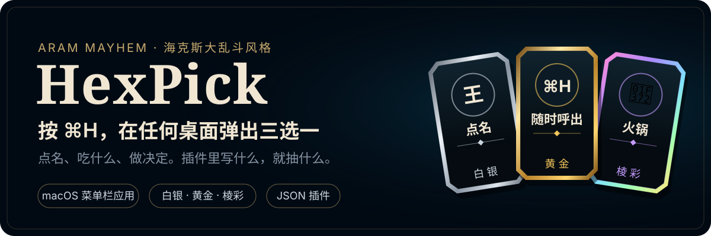
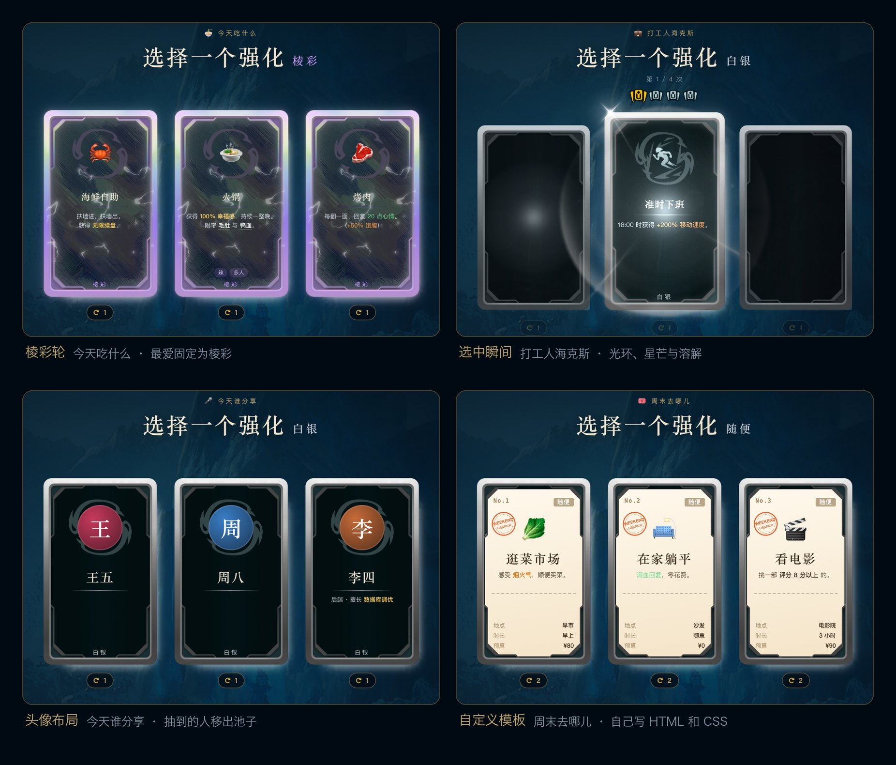

<p align="center">
  
</p>

<p align="center">
  
  
  
</p>

开会点人、课堂提问、中午吃什么，交给一次海克斯三选一。
HexPick 常驻菜单栏，在任何应用里按 **⌘H**，当前屏幕就会弹出和游戏里一样的强化选择界面。卡片里抽什么，由你写的插件决定。

<p align="center">
  
</p>

## 和游戏一样的规则

规则照搬英雄联盟「海克斯大乱斗」的强化选择：

- **一局 4 次选择**，每次三选一。三张卡是同一品质：白银、黄金或棱彩。
- **每张卡可以刷新一次**，刷新出来的仍是同品质。
- **本局出现过的不会再出现**，第 1、2 次选择不会都是白银。
- **金色刷新**：白银或黄金轮里，偶尔有一张卡的刷新按钮是金色的，刷新后升一档。
- **选中后**，其余卡片溶解消失，自动进入下一次选择，一局结束后展示本局选中的全部卡片。

卡底、品质边框、光泽、溶解、刷新擦出、棱彩电弧和嚎哭深渊背景，全部使用游戏原版素材。

## 快速开始

1. 打包安装包，或从 Releases 下载（如已发布）：

   ```sh
   npm install
   npm run dist:mac
   open release/HexPick-0.1.0-arm64.dmg
   ```

2. 把 HexPick 拖进「应用程序」。安装包没有正式签名，首次打开需要在「系统设置 → 隐私与安全性」里点「仍要打开」。
3. 启动后菜单栏会出现一个六边形图标，没有窗口，也没有 Dock 图标。在任意应用里按 **⌘H** 呼出。

浮层里的操作：

| 按键 | 作用 |
|---|---|
| `1` `2` `3` | 选择对应的卡 |
| `R` | 刷新鼠标悬停的卡 |
| `Space` | 下一次选择 / 再来一局 / 跳过等待 |
| `Tab` | 切换插件 |
| `M` | 静音 |
| `Esc` | 关闭 |

> ⌘H 原本是 macOS「隐藏应用」的快捷键。不想占用的话，在菜单栏图标 → 设置里点一下快捷键框，按下新的组合键即可。

## 插件使用方法

插件决定抽什么、卡片长什么样、规则怎么走。首次启动会自动创建插件目录，并放入 4 个示例插件和一份编写指南：

```text
~/Library/Application Support/HexPick/plugins/
```

菜单栏图标 → 设置 → 插件，可以新建插件、打开目录、启用或停用插件、查看加载错误。**插件文件保存后自动生效，不用重启。**

### 1. 最简插件：一个文件夹 + 一个 plugin.json

```text
plugins/
  my-team/
    plugin.json
```

```json
{
  "name": "今天谁分享",
  "layout": "portrait",
  "rules": { "screens": 1, "removeAfterPick": true },
  "items": ["张三", "李四", "王五", "赵六"]
}
```

`removeAfterPick` 打开后，抽到的人会移出池子，适合轮流点名。全部抽完后，在浮层里点「重置已选」。

### 2. 给条目加品质、描述和图标

```json
{
  "name": "今天吃什么",
  "icon": "🍜",
  "rules": { "screens": 1 },
  "items": [
    { "title": "火锅", "icon": "🍲", "rarity": "prismatic", "description": "<gold>幸福感 +100%</gold>" },
    { "title": "烤肉", "icon": "🥩", "rarity": "gold", "weight": 2, "tags": ["多人"] },
    { "title": "沙县小吃", "icon": "🥟", "rarity": "silver" },
    { "title": "随便", "description": "不写 rarity 时跟随本轮品质" }
  ]
}
```

| 条目字段 | 说明 |
|---|---|
| `title` | 必填，卡片名称 |
| `description` | 描述，支持下面的描述标签 |
| `icon` | emoji、插件目录里的图片，或 `lol:名称` 引用游戏原版强化图标 |
| `image` | 插件目录里的大图，头像布局优先使用 |
| `rarity` | `silver` / `gold` / `prismatic`。写了就固定品质，只在对应品质轮出现 |
| `weight` | 权重，默认 1，越大越容易出现 |
| `tags` | 小标签，最多 8 个 |
| `data` | 任意自定义字段，供自定义模板使用 |

图标示例：`"icon": "🍲"`、`"icon": "assets/hotpot.png"`、`"icon": "lol:adamant"`。

### 3. 描述标签

| 写法 | 效果 |
|---|---|
| `<gold>1750 金币</gold>` | 金色数值 |
| `<keyword>护盾</keyword>` | 关键词高亮 |
| `<ap>` `<ad>` `<heal>` `<shield>` `<true>` | 法强、攻击、治疗、护盾、真实伤害配色 |
| `<b>` `<i>` `<br>` | 粗体、斜体、换行 |
| `<color value="#ff5577">文字</color>` | 任意颜色 |

### 4. 调整规则

所有字段都可省略，默认值与游戏一致。

```json
"rules": {
  "screens": 4,
  "drawCount": 3,
  "rerollsPerCard": 1,
  "rarityWeights": { "silver": 50, "gold": 45, "prismatic": 5 },
  "goldenRerollChance": 0.15,
  "noRepeat": "session",
  "removeAfterPick": false,
  "pickTimer": 0
}
```

| 字段 | 默认 | 说明 |
|---|---|---|
| `screens` | 4 | 一局几次选择。设为 1 时选完直接开新局 |
| `drawCount` | 3 | 每次几张卡，1 到 5 |
| `rerollsPerCard` | 1 | 每张卡可刷新次数，0 为不能刷新 |
| `rarityWeights` | 50/45/5 | 每次选择掷品质的权重。官方未公布，默认取社区实测值 |
| `goldenRerollChance` | 0.15 | 白银、黄金轮出现金色刷新的概率 |
| `noRepeat` | `session` | 本局出现过的不再出现；`none` 只排除已选中的 |
| `removeAfterPick` | false | 选中的条目跨局移除 |
| `pickTimer` | 0 | 倒计时秒数，到时随机选一张；0 为关闭 |

### 5. 排版与主题

`layout` 选择内置布局，卡框和背景始终是游戏原版：

| `layout` | 适合 |
|---|---|
| `augment` | 默认，游戏原样：图标、名称、描述 |
| `portrait` | 点名：大头像，没有图片时自动生成首字头像 |
| `text` | 投屏：大字 |

`theme` 可以改品质名称、文字配色、字体、背景和音效：

```json
"theme": {
  "labels": { "silver": "随便", "gold": "心动", "prismatic": "必去" },
  "colors": { "gold": "#ff9f5a", "accent": "#ffb36b" },
  "backgroundImage": "abyss",
  "sounds": { "prismatic": "sounds/wow.mp3", "pick": "sounds/pick.mp3" }
}
```

`backgroundImage` 可填 `abyss`（嚎哭深渊，默认）、`none`（只暗化桌面）或插件目录里的图片。

### 6. 完全自定义卡面

在插件里加 `"template": "card.html"` 和 `"style": "style.css"`，卡面内容就由你的 HTML 和 CSS 决定。示例插件 `weekend/` 用它做了一张票根。

```html
<div class="ticket">
  <h2>{{title}}</h2>
  <p>{{{description}}}</p>
  {{#data.budget}}<p>预算 ¥{{data.budget}}</p>{{/data.budget}}
  {{^data.budget}}<p>免费</p>{{/data.budget}}
</div>
```

模板里的图片写插件目录内的相对路径，例如 `assets/stamp.svg`。

| 模板写法 | 含义 |
|---|---|
| `{{title}}` | 转义输出 |
| `{{{description}}}` | 按描述标签渲染 |
| `{{data.xxx}}` | 自定义字段 |
| `{{#字段}}…{{/字段}}` | 有值时显示 |
| `{{^字段}}…{{/字段}}` | 没值时显示 |

可用变量：`id` `title` `description` `icon` `iconUrl` `image` `tags` `rarity` `rarityLabel` `golden` `index` `plugin.name` `data.*`。
模板外层带有 `card rarity-<品质>` 类名，可以按品质写样式。每张卡运行在独立的 Shadow DOM 里，插件 CSS 不会影响主界面。

**安全限制**：插件只能包含数据、HTML 和 CSS，不能执行脚本。模板中的脚本、iframe、事件属性和外部链接会被移除，图片和音效只能读取插件自己目录里的文件。所以别人分享给你的插件可以放心使用。

完整的字段说明见 [plugins/README.md](plugins/README.md)，这份文件也会复制到你的插件目录里。

## 从源码运行

```sh
npm install
npm run dev          # Electron 开发模式
npm run dev:web      # 只看界面：http://localhost:5199/index.html?plugin=workday
npm test             # 单元测试
npm run typecheck    # 类型检查
npm run dist:mac     # 打包 dmg 到 release/
node tools/fetch-game-assets.mjs   # 重新下载游戏素材
```

| 目录 | 内容 |
|---|---|
| `src/shared` | 抽卡规则引擎、插件格式校验、模板引擎，纯函数，带单元测试 |
| `src/main` | 主进程：快捷键、菜单栏、浮层窗口、插件加载与热更新 |
| `src/renderer` | 浮层与设置界面 |
| `assets/game` | 游戏素材 |
| `plugins` | 示例插件与插件编写指南 |

在源码目录里运行时，终端可能打印 `sandbox_extension_issue_file failed`。这是项目放在受保护的「文稿」文件夹时 macOS 给出的警告，不影响使用。

## 限制

- 仅支持 macOS（Apple Silicon，macOS 13 及以上）。
- 安装包只有临时签名，首次打开需要手动允许。
- 音效是实时合成的。游戏原版音效封装在音频包里，暂未接入，插件可以自带音效替换。
- 独占全屏的游戏会盖住浮层。

## 版权

代码采用 MIT 许可。

`assets/game/` 下的卡片、背景、特效与强化图标来自《英雄联盟》，版权归 Riot Games, Inc. 所有，不适用 MIT 许可，详见 [assets/game/NOTICE.md](assets/game/NOTICE.md)。HexPick 是非商业粉丝工具，与 Riot Games 无关联，也未获其认可。
